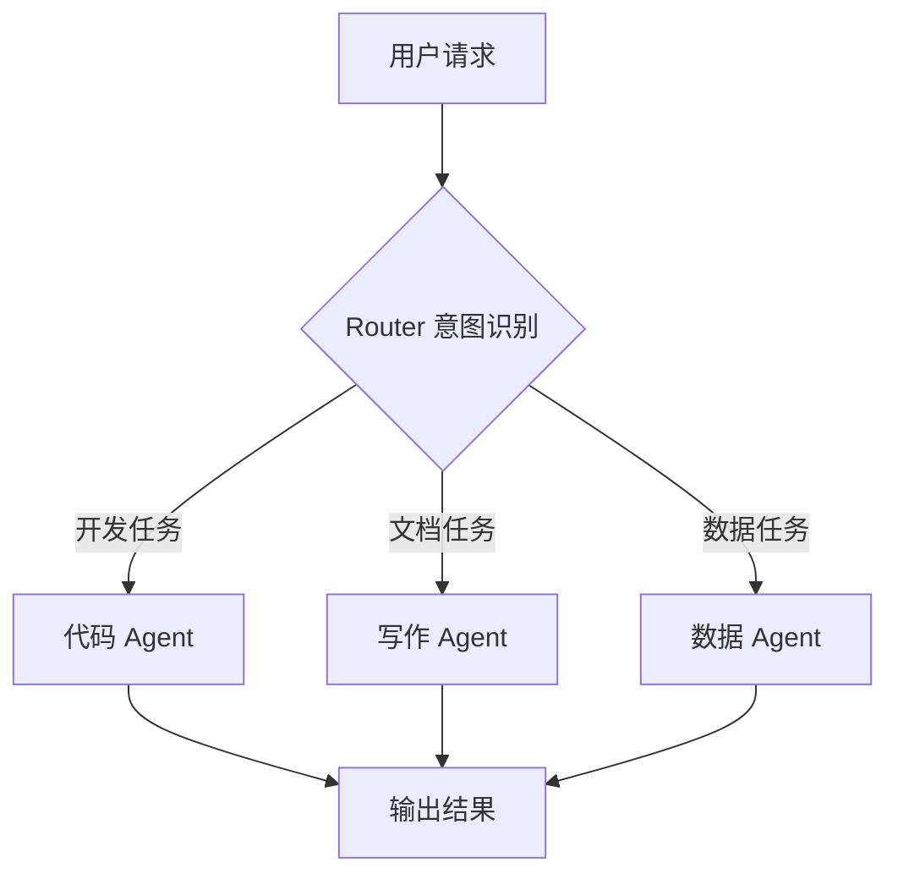

# Router：路由分发架构

**核心原理：** 先识别用户意图，再将任务发送到最合适的智能体。

例如用户提出三个不同问题：

- “帮我修改 Java 接口”：路由至开发 Agent。
- “帮我写正式工作报告”：路由至写作 Agent。
- “帮我分析 PostgreSQL 数据”：路由至数据 Agent。

Router 可以由规则引擎、分类模型或 LLM 实现。

**Router 与 Supervisor 的区别：**

Router 的核心任务是*选谁*。很多情况下，路由完成后就不再参与。

Supervisor 不仅选择执行者，还会持续跟踪任务，决定是否需要再次调用其他 Agent，并负责汇总最终结果。

**优点：** 执行效率高，可以针对不同问题选用不同模型、工具和提示词；任务分类明确时，能够明显减少不必要的调用。

**缺点：** 对意图分类质量依赖较高；一个请求跨越多个领域时，单一路由可能无法满足需求。

**适用场景：** 智能客服、企业知识库、综合服务入口、多模型成本优化。

Google ADK 将类似模式称为 Coordinator/Dispatcher。

## 对话中的产品案例

**待补充。** 原对话仅提供说明性场景，未给出可直接提取并归属本模式的真实产品实例。

## 来源与核验

- 架构说明和场景摘自对话《多智能体架构详解》（ID：`6ae9876b-eba0-83ec-881f-df52a5d79c38`）。
- 产品描述来自同一对话；具体版本和实现需再次核验。

