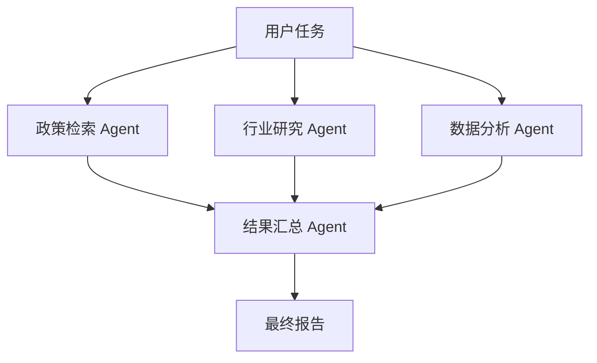

# Parallel：并行协作架构

**核心原理：** 将彼此没有前置依赖的任务分配给多个智能体，同时执行，最后汇总。

假设生成一份行业研究报告，需要获取政策背景、行业趋势、竞争产品信息。

这三项研究可以同时进行，而不必一个接一个执行。

并行执行主要有两种方式：

**① 任务拆分型（Sectioning）**

每个 Agent 负责不同任务，例如一个检索政策、一个研究市场、一个处理数据。

**② 多视角分析型（Voting / Independent Evaluation）**

多个 Agent 分别分析同一个任务，再比较结果。例如三个安全 Agent 使用不同分析策略审查同一份代码。

理想情况下，假设三个独立任务各耗时 10 秒：

- 串行执行约需 30 秒。
- 完全并行执行约需 10 秒，再加汇总和通信开销。

但并行并不意味着一定节省 Token，甚至可能由于重复分析而增加总成本。

**优点：** 降低端到端延迟、便于扩展处理能力、支持独立观点交叉验证。

**缺点：** 需要处理并发、结果冲突、任务失败与超时；共享状态不当时容易发生数据覆盖。

**适用场景：** 多源信息检索、代码审查、市场研究、安全检测、多维度报告分析。

实际工程中推荐采用 `Fan-out / Fan-in` 模式：先并行分发，再集中合并。

## 对话中的产品案例

Claude Research：多个研究子 Agent 同时检索不同方向。[官方工程文章](https://www.anthropic.com/engineering/multi-agent-research-system)

Cursor：多个编码 Agent 在隔离环境中并行工作或比较方案。[产品更新](https://cursor.com/changelog/2-0)

Manus Wide Research：原对话描述按研究对象拆分，由多个独立实例并行完成。

## 来源与核验

- 架构说明和场景摘自对话《多智能体架构详解》（ID：`6ae9876b-eba0-83ec-881f-df52a5d79c38`）。
- 产品描述来自同一对话；具体版本和实现需再次核验。

