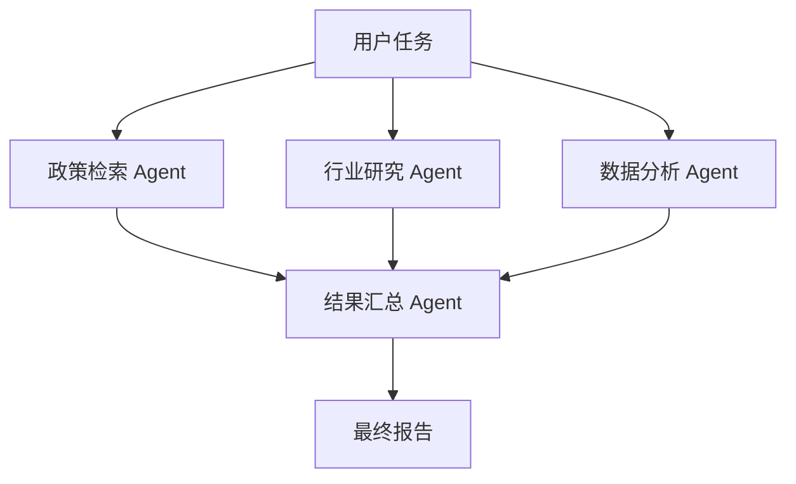

# Parallel：并行协作架构

**核心原理：** 将彼此没有前置依赖的任务分配给多个智能体，同时执行，最后汇总。

假设生成一份行业研究报告，需要获取政策背景、行业趋势、竞争产品信息。

这三项研究可以同时进行，而不必一个接一个执行。

并行执行主要有两种方式：

**① 任务拆分型（Sectioning）**

每个 Agent 负责不同任务，例如一个检索政策、一个研究市场、一个处理数据。

**② 多视角分析型（Voting / Independent Evaluation）**

多个 Agent 分别分析同一个任务，再比较结果。例如三个安全 Agent 使用不同分析策略审查同一份代码。

理想情况下，假设三个独立任务各耗时 10 秒：

- 串行执行约需 30 秒。
- 完全并行执行约需 10 秒，再加汇总和通信开销。

但并行并不意味着一定节省 Token，甚至可能由于重复分析而增加总成本。

**优点：** 降低端到端延迟、便于扩展处理能力、支持独立观点交叉验证。

**缺点：** 需要处理并发、结果冲突、任务失败与超时；共享状态不当时容易发生数据覆盖。

**适用场景：** 多源信息检索、代码审查、市场研究、安全检测、多维度报告分析。

实际工程中推荐采用 `Fan-out / Fan-in` 模式：先并行分发，再集中合并。

## 产品案例

### Claude Research：按研究主题并行

示例需求是分析 AI 编程工具的市场、技术与商业模式。主智能体把各主题交给不同的研究子智能体，同时检索，再汇总证据；信息不足时可以继续发起下一轮研究。

### Cursor：隔离环境中的并行开发

示例需求是修改 Spring Boot + Vue 项目的用户管理功能，同时调整前端、后端和测试。多个智能体可以处理不同模块或对同一问题提出不同方案。各自使用隔离的代码环境，最后审查并合并修改，避免互相覆盖文件。若前端严格依赖后端接口，应先约定接口再并行。

### Manus Wide Research：按研究对象并行

示例需求是调查 100 家 AI 企业并汇总为表格。每家公司是一个相对独立的子任务，可以交给具备完整工具能力的通用智能体实例；各实例在独立环境中研究，主任务再汇总结果。这里的切分单位是“研究对象”，不必预先为每个专业领域固定一个智能体。
