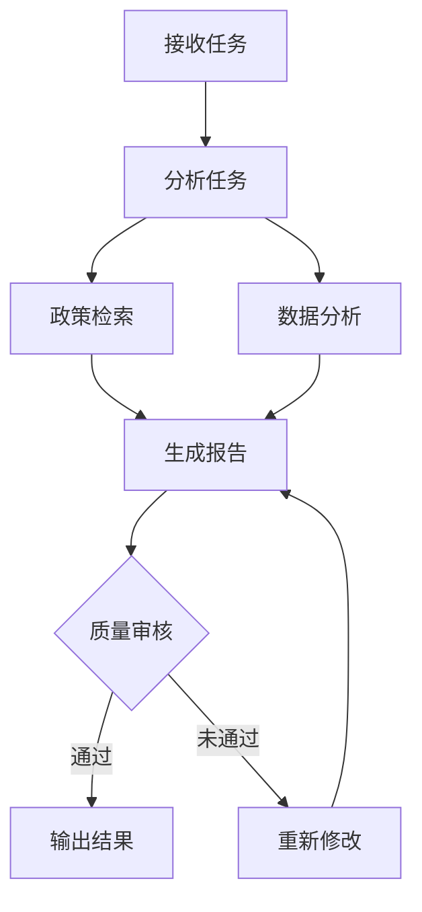

# Graph / DAG：图工作流架构

这是构建复杂 Agent 系统时非常重要的架构。

**核心原理：** 将整个工作流表示为一张图。

- Node（节点）：执行某个任务的 Agent、工具或普通函数。
- Edge（边）：定义节点之间的执行关系。
- State（状态）：记录工作流的上下文和中间结果。
- Condition（条件）：根据执行结果决定下一步。

例如：

这里必须区分 **DAG 和一般 Graph**。

DAG（Directed Acyclic Graph，有向无环图）不允许形成循环，因此特别适合描述明确的任务依赖关系，例如数据 ETL 和批处理。

Graph 可以包含循环，能够实现“生成 → 审核 → 重新生成”的反复迭代。

因此，严格来说，**包含审核回环的 Agent 工作流属于有向图，而不是 DAG。**

**优点：** 能表达复杂依赖、条件分支、并行及循环；适合保存执行状态、支持中断恢复和可视化调试。

**缺点：** 图结构复杂后会增加编排和状态管理成本；如果每个分支都交给大模型动态判断，调试难度也会明显增加。

**适用场景：** 企业业务流程、复杂 RAG、多阶段审批、自动化研发和对可靠性要求较高的 Agent 系统。

以 LangGraph（有状态的智能体工作流编排框架）为例，它通过状态、节点和连接关系管理工作流，支持条件分支、循环和状态持久化。

## 对话中的产品案例

**待补充。** 原对话仅提供说明性场景，未给出可直接提取并归属本模式的真实产品实例。

## 来源与核验

- 架构说明和场景摘自对话《多智能体架构详解》（ID：`6ae9876b-eba0-83ec-881f-df52a5d79c38`）。
- 产品描述来自同一对话；具体版本和实现需再次核验。

