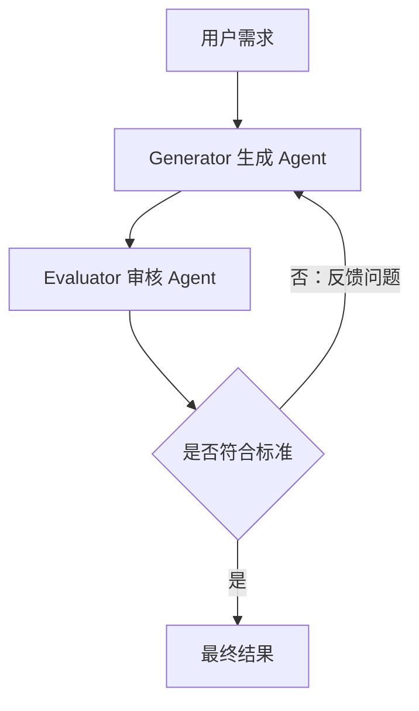

# Evaluator-Optimizer：评估优化循环架构

这种架构特别适合写作、代码生成、方案设计等对结果质量要求较高的任务。

**核心原理：** 将内容生成与质量审核拆分给不同智能体，并建立反馈闭环。

例如，构建正式公文写作系统。

写作 Agent 首先生成初稿；审核 Agent 从公文结构、政策引用、事实准确性、语言风格等维度审核。

如果审核结果为“不通过”，生成修改意见，再交给写作 Agent 进行下一轮处理。

这里还可以进一步区分两种形式：

**① Generator-Critic：正确性审核**

重点是内容是否满足明确标准，例如 SQL 能否执行、JSON 是否符合 Schema、引用文献是否存在。

**② Iterative Refinement：质量优化**

重点是改善结果，例如结构更合理、语言更精练、论证更充分。

前者更容易采用确定性标准，后者通常需要综合评价。

**优点：** 能持续发现并修正问题，提高结果质量；适用于难以一步生成高质量输出的任务。

**缺点：** 容易陷入无限修改；两个 Agent 可能相互否定；增加模型调用开销；LLM 审核本身也可能出错。

生产环境至少应设置：

- 最大迭代次数，例如 3 次。
- 明确的审核标准和通过阈值。
- 保留上一轮版本，防止修改后质量退化。
- 对事实核查使用外部权威来源或程序校验，而不是完全相信审核 Agent。

这种模式也是 Anthropic 和 Google ADK 官方重点介绍的工作流之一。

## 对话中的产品案例

Claude Research：主 Agent 汇总结果后决定是否继续研究。该例体现迭代机制，但原对话没有将其明确归类为完整的评估优化架构。[官方工程文章](https://www.anthropic.com/engineering/multi-agent-research-system)

## 来源与核验

- 架构说明和场景摘自对话《多智能体架构详解》（ID：`6ae9876b-eba0-83ec-881f-df52a5d79c38`）。
- 产品描述来自同一对话；具体版本和实现需再次核验。

