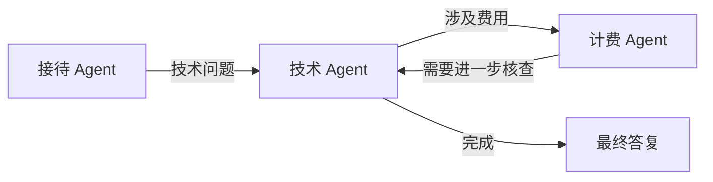

# Handoff / Swarm：智能体交接架构

**核心原理：** 不设置始终负责全部任务的主控，而是允许智能体根据当前任务将控制权转移给另一个智能体。

例如用户咨询云服务器：

接待 Agent 首先接收需求。发现是网络故障后，交接给网络 Agent。网络 Agent 发现问题涉及安全策略，再交接给安全 Agent。

在这样的系统中，当前活跃的 Agent 可以自行决定下一步交接对象。

**它与 Supervisor 最关键的区别是控制权归属。**

- Supervisor：子智能体完成任务后，结果返回主控，主控继续调度。
- Handoff：当前智能体直接将执行控制权交给下一个智能体。

Swarm 通常指基于这种动态交接建立的多智能体协作网络。需要注意，Swarm 在不同框架中的具体含义略有差异，并不一定意味着大规模并行。

**优点：** 智能体自主性高、组织灵活、避免所有请求都经过中央管理者。

**缺点：** 可能发生循环交接、重复执行、上下文丢失或责任归属不明确。

**适用场景：** 客服转接、交互式助手、跨领域连续对话、专家协作。

