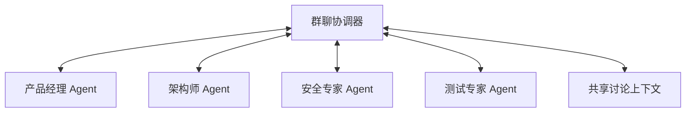

# Group Chat：群聊协商架构

**核心原理：** 多个智能体参与同一段共享会话，通过轮流发言、讨论、质疑、补充观点完成任务。

例如，设计一套企业 AI 管理平台。

产品经理 Agent 提出功能需求，架构师 Agent 分析技术实现，安全专家 Agent 指出权限及数据保护风险，测试专家 Agent 进一步分析可测试性。

各个 Agent 能够看到其他参与者的意见，并不断补充和完善。

通常需要一个 Group Chat Manager 控制：

- 谁可以发言。
- 按什么顺序发言。
- 是否允许继续讨论。
- 达到什么条件结束讨论。

**与 Pipeline 的区别：** Pipeline 强调阶段之间的数据传递；Group Chat 强调多个参与者对共享问题的持续交流。

**优点：** 有利于多视角分析、需求澄清、创意生成和复杂方案评审。

**缺点：** 容易产生无意义讨论、观点趋同、上下文膨胀以及大量 Token 消耗。

**适用场景：** 技术方案评审、需求分析、战略研讨、创意设计。

Microsoft Agent Framework 将 Group Chat 作为内置编排模式，支持轮流发言和自定义发言选择策略。
