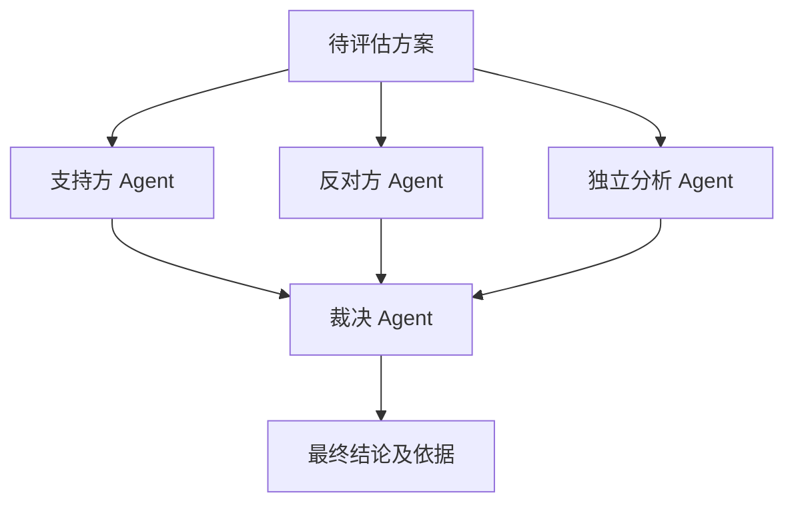

# Debate / Voting：辩论与投票架构

这种架构通常可以视为并行分析和群聊协商的一种特殊组合。

**核心原理：** 多个智能体使用不同立场或独立推理路径，对同一个问题进行分析，再通过裁决或聚合机制得出结果。

例如，评估某业务系统是否适合迁移到微服务架构。

支持方分析可扩展性和模块解耦价值，反对方分析维护复杂度及成本，独立 Agent 根据客观技术指标判断，裁决 Agent 汇总各方论据。

这种模式包含两类典型方案：

**Debate：** 允许智能体互相质疑、反驳和修正观点。

**Voting：** 多个智能体独立得出判断后，采用多数投票、加权投票或规则融合。

**优点：** 能发现单一推理路径中的盲点；适合需要解释不同选择利弊的任务。

**缺点：** 多数意见不一定正确，尤其当多个 Agent 使用相同模型、相同数据源时，错误可能高度相关。

**适用场景：** 架构选型、风险评估、复杂决策、代码安全审查。

对于有客观标准的任务，最终应以实际测试、可信数据和确定性检查为依据，而不能单纯依靠智能体投票。

## 对话中的产品案例

**待补充。** 原对话仅提供说明性场景，未给出可直接提取并归属本模式的真实产品实例。

## 来源与核验

- 架构说明和场景摘自对话《多智能体架构详解》（ID：`6ae9876b-eba0-83ec-881f-df52a5d79c38`）。
- 产品描述来自同一对话；具体版本和实现需再次核验。

