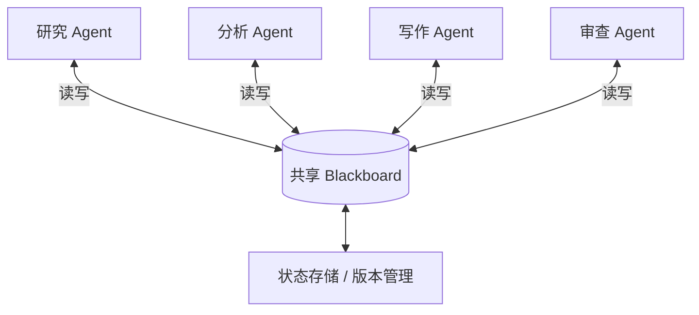

# Blackboard：黑板共享架构

**核心原理：** 不要求智能体之间直接通信，而是通过一个统一的共享工作空间来交换信息。

这类似多位专家在同一块黑板上工作。

例如，构建一个大型科研分析系统。

检索 Agent 将文献证据写入共享空间，分析 Agent 读取证据并更新研究结论，写作 Agent 根据结论生成报告，审查 Agent 再把发现的问题写回共享空间。

共享空间可以采用：

- PostgreSQL 或 Redis 存储结构化状态。
- 对象存储保存文档、代码及大型中间成果。
- 共享任务状态记录进度、负责人、版本。
- 向量数据库负责相关知识检索。

但要注意，**共享状态不等于让所有 Agent 都读取全部历史信息**。

高效实现通常需要细粒度的状态隔离：每个 Agent 只读取执行自身任务所需的上下文。

**优点：** 降低智能体之间的直接耦合，支持中间成果复用，有利于异步协作和故障恢复。

**缺点：** 存在并发写入冲突、数据版本不一致、状态污染和权限隔离问题。

**适用场景：** 长周期研究、大型软件研发、多人多智能体协作、需要共享中间成果的复杂任务。

Blackboard 更多是一种通信和共享状态模式，可以与 Supervisor、Graph 或 Event-Driven 架构同时使用。

## 相关产品做法

### Genspark Super Agent：共享上下文的相关做法

示例需求是同时生成报告、演示文稿和财务表。各专业智能体基于同一份上下文快照工作，结果返回后由主智能体统一更新上下文，以减少产品名称、数据口径等内容不一致的问题。它展示了共享状态和版本控制的价值；具体做法是主控统一更新快照，并非所有智能体都直接写入同一块黑板。
