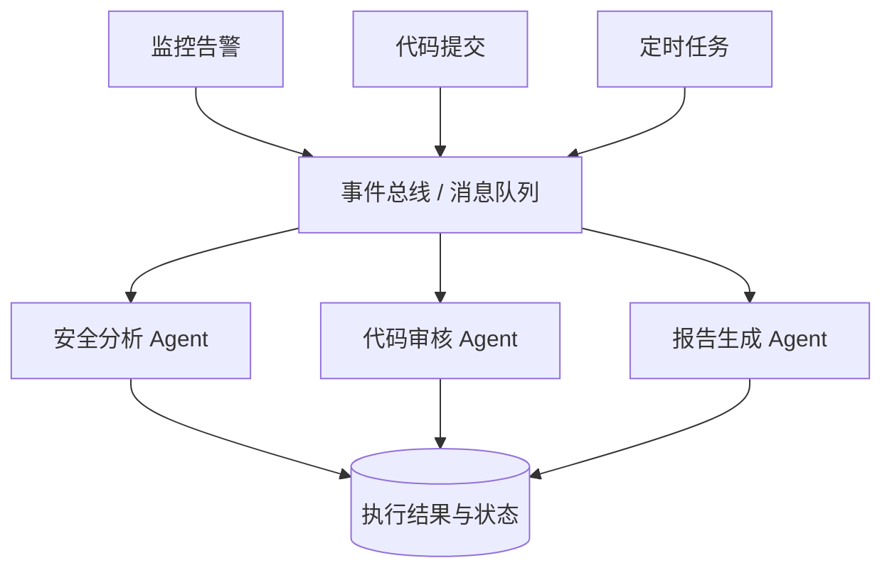

# Event-Driven：事件驱动架构

**核心原理：** 智能体不必持续等待上级调用，而是由系统中的特定事件触发执行。

例如，建设一个自动化安全运营系统。

当监控平台产生异常登录告警时：

1. 告警事件进入消息队列。
2. 安全分析 Agent 自动获取相关日志。
3. 威胁情报 Agent 查询 IP 风险信息。
4. 研判 Agent 汇总并形成初步结论。
5. 达到指定风险级别后，通知工作人员审核处置建议。

事件驱动可以结合 Kafka、RabbitMQ、Redis Streams 等技术实现。

**优点：** 解耦生产者与消费者、支持异步执行、适合高并发事件处理，也便于横向扩容。

**缺点：** 需要处理事件重复、乱序、失败重试、幂等性和最终一致性。

**适用场景：** 安全运营、智能运维、CI/CD、告警处理、自动化业务系统。

它与前面的模式可以组合。例如某条告警触发一个 Supervisor，再由 Supervisor 启动内部 Pipeline。

## 对话中的产品案例

**待补充。** 原对话仅提供说明性场景，未给出可直接提取并归属本模式的真实产品实例。

## 来源与核验

- 架构说明和场景摘自对话《多智能体架构详解》（ID：`6ae9876b-eba0-83ec-881f-df52a5d79c38`）。
- 产品描述来自同一对话；具体版本和实现需再次核验。

