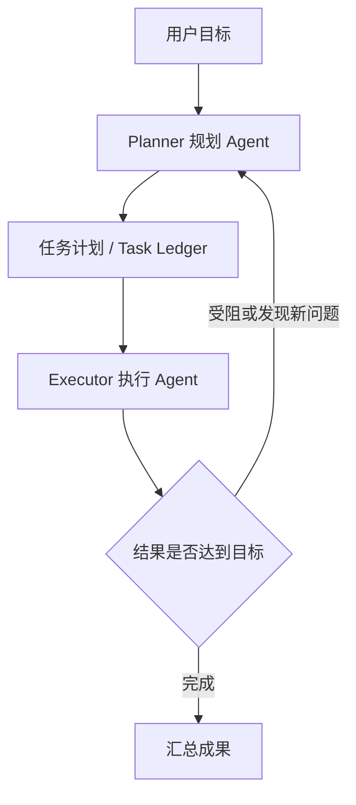

# Planner-Executor：动态规划执行架构

**核心原理：** 先制定执行计划，再交由执行智能体完成；根据执行反馈动态调整计划。

例如用户要求：

> 自动完成一个 Spring Boot + Vue 项目的开发、测试和部署。

Planner 最初可能制定计划：

需求分析 → 数据库设计 → 后端开发 → 前端开发 → 自动化测试 → 部署。

但执行过程中发现后端使用的数据库结构与既有数据不兼容。

Executor 将问题反馈给 Planner，Planner 调整计划，新增数据库迁移和接口兼容性改造任务。

**与 Supervisor 的区别：**

两者存在重叠，但侧重点不同。

Supervisor 强调由谁执行任务，以及如何委派。

Planner-Executor 更强调**持续维护和修订任务计划**，尤其适合一开始无法预知完整执行路径的任务。

**优点：** 对未知问题和执行变化的适应能力强，适合开放式、多步骤任务。

**缺点：** 规划本身会消耗模型调用；可能反复重新规划、偏离原目标，甚至陷入执行循环。

**适用场景：** 软件开发、复杂研究、自动化故障排查、长流程任务。

## 产品案例

### Perplexity Computer：规划后按依赖执行

示例需求是调查 10 家 AI 软件公司的产品、价格和融资情况，形成对比表，再制作演示文稿。规划模块拆分目标，调度模块分配搜索、数据整理、分析和内容制作任务。资料收集先于比较分析，演示文稿又依赖分析结论，因此需要按结果调整后续步骤。

### ChatGPT Deep Research：根据发现改变研究路径

示例需求是检索中央及地方数字经济政策并形成报告。系统先规划检索策略，搜索和阅读资料，再检查信息是否充分；发现缺口时调整方向并继续查找。这个例子说明动态规划与迭代检索的流程，不能仅凭这一流程推断底层运行了多少个智能体。
