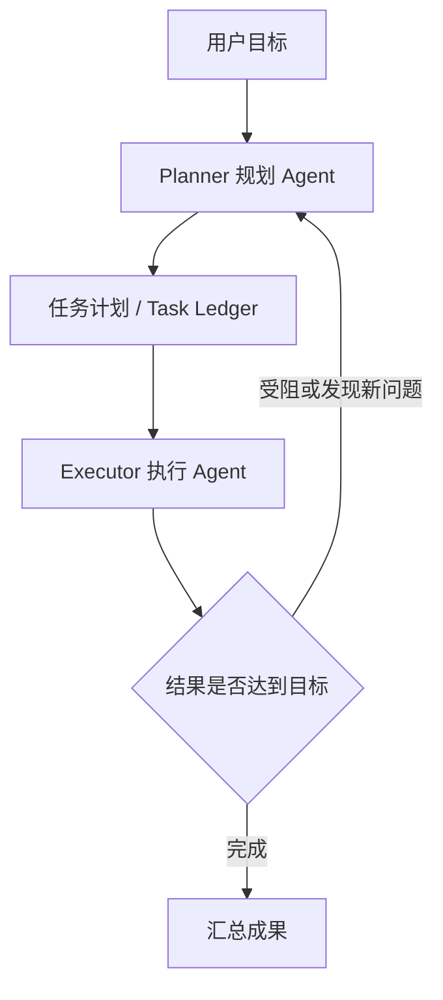

# Planner-Executor：动态规划执行架构

**核心原理：** 先制定执行计划，再交由执行智能体完成；根据执行反馈动态调整计划。

例如用户要求：

> 自动完成一个 Spring Boot + Vue 项目的开发、测试和部署。

Planner 最初可能制定计划：

需求分析 → 数据库设计 → 后端开发 → 前端开发 → 自动化测试 → 部署。

但执行过程中发现后端使用的数据库结构与既有数据不兼容。

Executor 将问题反馈给 Planner，Planner 调整计划，新增数据库迁移和接口兼容性改造任务。

**与 Supervisor 的区别：**

两者存在重叠，但侧重点不同。

Supervisor 强调由谁执行任务，以及如何委派。

Planner-Executor 更强调**持续维护和修订任务计划**，尤其适合一开始无法预知完整执行路径的任务。

**优点：** 对未知问题和执行变化的适应能力强，适合开放式、多步骤任务。

**缺点：** 规划本身会消耗模型调用；可能反复重新规划、偏离原目标，甚至陷入执行循环。

**适用场景：** 软件开发、复杂研究、自动化故障排查、长流程任务。

Microsoft Agent Framework 的 Magentic 模式属于这类动态规划协调方式的代表之一。

## 对话中的产品案例

ChatGPT Deep Research：原对话描述动态规划、检索、分析信息缺口和调整方向；同时指出其底层多 Agent 拓扑未充分披露。

Perplexity Computer：原对话描述 Planner 拆解任务、Orchestrator 分配专业子 Agent。

## 来源与核验

- 架构说明和场景摘自对话《多智能体架构详解》（ID：`6ae9876b-eba0-83ec-881f-df52a5d79c38`）。
- 产品描述来自同一对话；具体版本和实现需再次核验。

