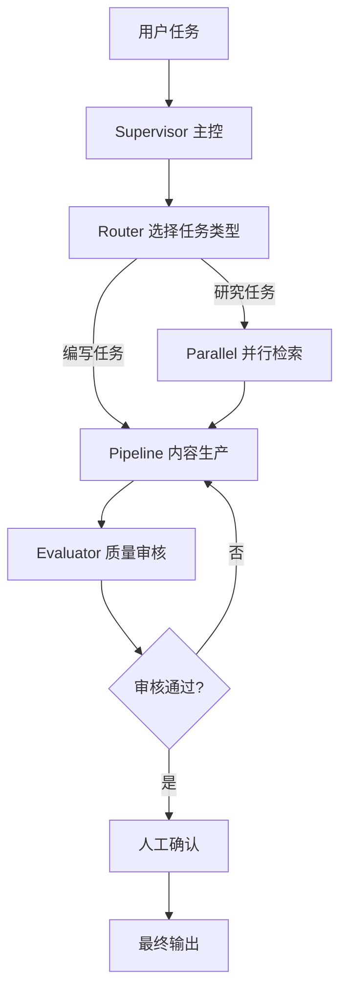

# Hybrid：混合式架构

**核心原理：** 将多种模式按任务特点组合，而不是使用一种架构承担所有工作。

例如：

这里同时包含：

- 主子智能体：统一理解和管理复杂任务。
- 路由：选择需要运行的专业流程。
- 并行：同时获取多个研究结果。
- Pipeline：完成固定的内容生产过程。
- 循环：反复检查并优化。
- 人工审核：在交付前进行最终确认。

**优点：** 兼顾灵活性、可靠性和效率。

**缺点：** 需要良好的任务契约、状态管理、异常处理和可观测性。

**适用场景：** 企业级 Agent 产品、复杂自动化平台、长期运行的业务系统。

混合架构的关键不是采用的模式越多越好，而是每个模式都要解决明确的问题。

## 组合示例

### 公文写作系统：多种模式组合

示例需求是撰写正式材料并核查政策依据。总控智能体先确定写作要求和大纲；政策检索与业务资料研究并行；证据汇总后由写作智能体生成正文；审查智能体检查结构、事实与引用；未通过时定向修订，达到轮次上限则交给人工；人工确认后生成文档。这里组合了主子协作、并行、流水线、评估循环与人工审核。

## 产品案例

### Genspark Super Agent：专业分工与统一上下文

示例需求是生成一套报告、演示文稿和财务表。主智能体选择不同的专业智能体并行制作，各智能体读取同一上下文快照，主智能体统一收集成果并更新上下文。这同时使用了主子、路由、并行和共享状态机制。
