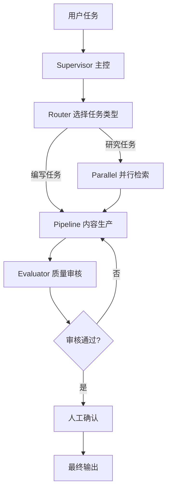

# Hybrid：混合式架构

**核心原理：** 将多种模式按任务特点组合，而不是使用一种架构承担所有工作。

例如：

这里同时包含：

- 主子智能体：统一理解和管理复杂任务。
- 路由：选择需要运行的专业流程。
- 并行：同时获取多个研究结果。
- Pipeline：完成固定的内容生产过程。
- 循环：反复检查并优化。
- 人工审核：在交付前进行最终确认。

**优点：** 兼顾灵活性、可靠性和效率。

**缺点：** 需要良好的任务契约、状态管理、异常处理和可观测性。

**适用场景：** 企业级 Agent 产品、复杂自动化平台、长期运行的业务系统。

混合架构的关键不是采用的模式越多越好，而是每个模式都要解决明确的问题。

## 对话中的产品案例

Genspark Super Agent：主控、专业 Agent、并行执行和统一上下文组合。[技术文章](https://www.genspark.ai/blog/genspark-multiagent-orchestration)

Lovable：并行只读探索与主 Agent 集中写入组合。[官方文章](https://lovable.dev/en/blog/subagents-in-lovable)

Perplexity Computer：规划、调度、专业子 Agent、模型路由和共享状态组合。

## 来源与核验

- 架构说明和场景摘自对话《多智能体架构详解》（ID：`6ae9876b-eba0-83ec-881f-df52a5d79c38`）。
- 产品描述来自同一对话；具体版本和实现需再次核验。

